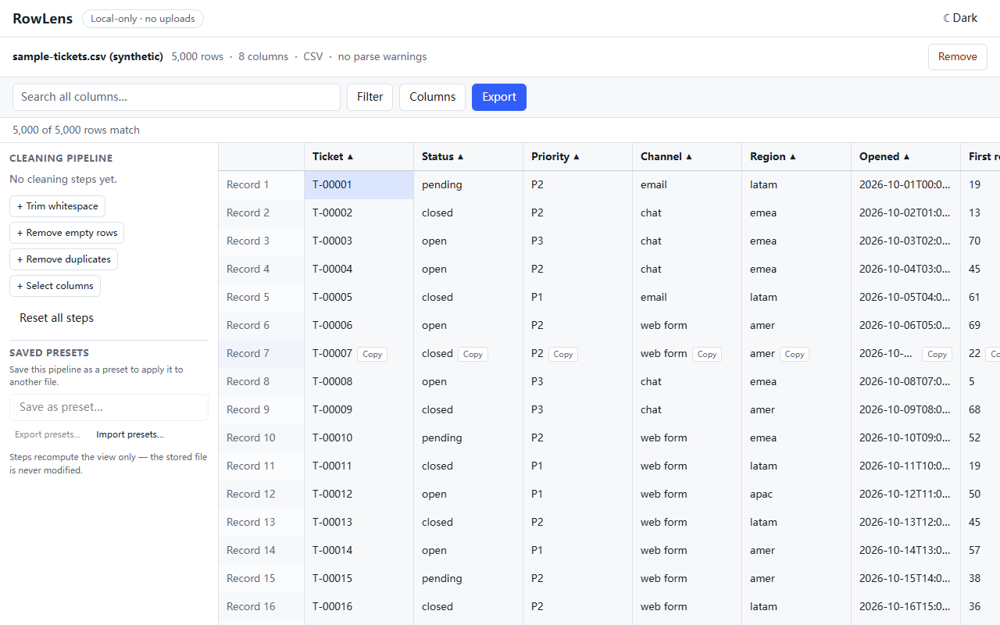
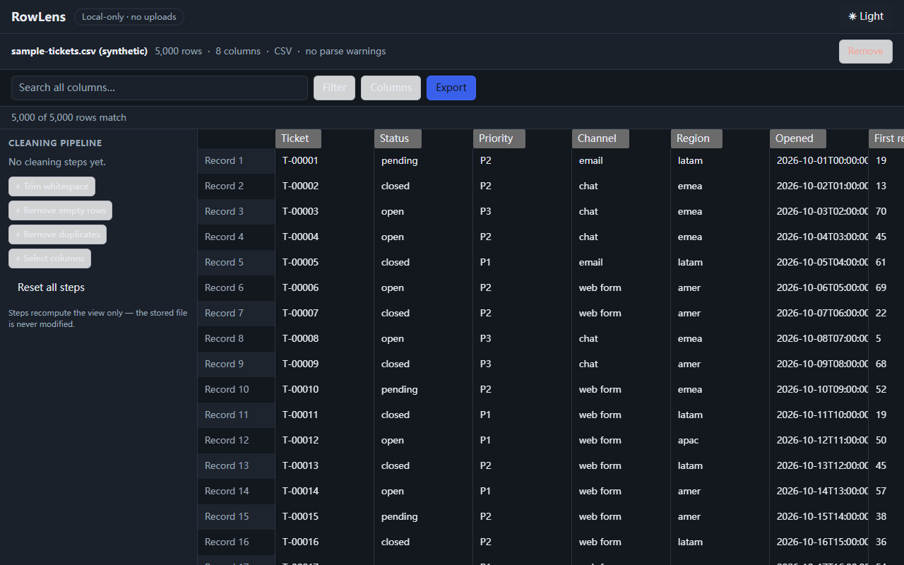
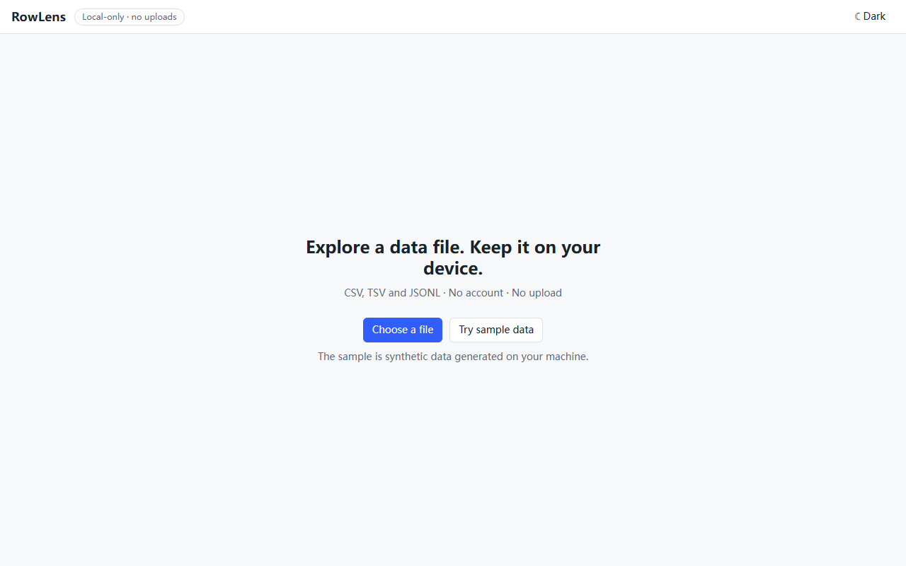
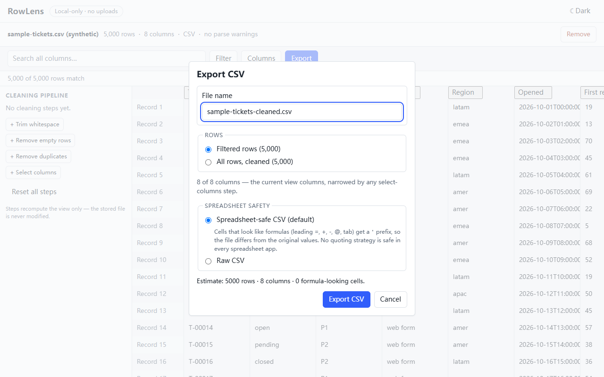

# RowLens

**A local-only CSV/TSV/JSONL viewer and cleaning workbench. Drag a file in, preview, search, clean and export — your data never leaves your device.**

| Light                                                                                               | Dark                                                             |
| --------------------------------------------------------------------------------------------------- | ---------------------------------------------------------------- |
|  |  |

- No account, no upload endpoint, no telemetry, no remote fonts or CDN runtime scripts.
- All parsing, cleaning and exporting happens in your browser; parsed records are temporarily cached in the browser's own IndexedDB storage and are never transmitted anywhere.
- Source files are read-only: RowLens only ever writes a **new** exported file.

## What it does

|                                                           |                                                                                   |
| --------------------------------------------------------- | --------------------------------------------------------------------------------- |
|                 |             |
| Choose a file, drop one, or explore the synthetic sample. | Filtered-vs-all scope, spreadsheet-safe vs raw export with distinct explanations. |

**Import** CSV, TSV and JSONL/NDJSON (≤ 100 MiB) through a Web Worker in
bounded batches with explicit backpressure; cancellation removes all partial
data. **Query** with literal case-insensitive search (`Status:open` targets one
column, whitespace-separated terms must all match), per-column filters,
stable string sort (with an explicit per-column "treat as numbers" mode:
`9` sorts before `1,050`, unparseable values partition after the numbers) and
column show/hide — run in a second worker over windowed
dataset scans, where the newest query always wins. **Clean** with serializable
steps (trim whitespace, remove empty rows, remove duplicates, select columns),
each showing its impact, never touching the stored file. **Export** CSV as the
filtered view, the cleaned dataset, or the selected rectangle, streamed to a File System Access save
picker when available (capped in-browser download otherwise), with
spreadsheet-safe formula protection by default and an explicit raw mode. A
toggle in the header switches between light and dark themes; until you pick
one the app follows the OS preference, and the choice is remembered locally.

All cell values stay strings — no implicit numeric or date conversion, so
leading zeros and date-like text are preserved exactly.

The grid is fully keyboard-operable: arrows/Home/End/PageUp/PageDown move the
active cell, the record header is one step to the left of the first column,
Shift+arrows or a drag extends a rectangular selection, Ctrl/Cmd+A selects the
view and Ctrl/Cmd+C copies the range as tab-separated text.

Cells are editable in place: Enter, F2, a double-click or just typing opens an
editor, Enter/Tab commits, Escape cancels, and Ctrl/Cmd+Z / Ctrl/Cmd+Shift+Z
step back and forth. Pasting tab-separated text fills cells from the active
cell (or tiles the block across a larger selection) as one undoable action.

Edits are an **overlay stored apart from the imported rows**: the source file
and the imported records are never rewritten, search and sort see the edited
values, and exports write them. The overlay is saved to its own IndexedDB
store, so reloading reopens the dataset you were viewing with its edits
intact — a reloaded session starts without undo history, and **Reset edits**
returns to the imported values. Up to 5,000 cells can be edited at once.

The cleaning pipeline is saved the same way and restored with the dataset, so
a reload does not lose the steps you configured. It stays configuration:
nothing is written back to the stored rows, and the view is always a projection
of the imported data through the current pipeline.

The query view is restored too — the search term, column filters, sort and
hidden columns. Reopening a dataset therefore returns to what you were looking
at rather than the unfiltered table; **Reset** clears all four and deletes the
saved view. Like the pipeline, it is configuration: no stored row changes.

A pipeline can also be saved as a named **preset** and applied to a different
file, which is the case a per-dataset pipeline cannot cover. Presets match
columns by header name, not position, so they still target the right column
when the next file orders its columns differently; a header name shared by
several columns is never guessed at — that step or column is skipped and
reported. Presets are stored globally and outlive the dataset they were
captured from.

Presets can also be **exported to a JSON file and imported again** — on another
browser or machine. A preset file contains configuration only (step types and
column header names; never cell values or file names), import validates every
entry and never overwrites a recipe you already have: a name collision is
skipped and reported, so you can rename and retry.

## Getting started

Requirements: Node.js **>= 22.12** (22 LTS or 24 LTS recommended) and npm.

```bash
npm ci        # reproducible install from package-lock.json
npm run dev   # start the Vite dev server
```

Then open the printed local URL, drop in a file — or try the bundled
synthetic demo (`public/demo-support-tickets.csv`, 2,000 rows) and the
built-in **Try sample data** table.

### Verification commands

```bash
npm run typecheck    # tsc --noEmit (strict mode)
npm run test:unit    # Vitest unit & component tests
npm run build        # typecheck + production build + network audit
npm run format:check # Prettier check
npm run test:e2e     # Playwright E2E (production preview server)
```

If the Playwright browser bundle cannot be downloaded, the suite can run on
an installed browser: `PLAYWRIGHT_CHANNEL=msedge npm run test:e2e` (or
`chrome`). The accessibility scans and the `PERF=1`-gated performance
benchmarks live in the same suite.

### CI

GitHub Actions runs `npm ci`, `typecheck`, `test:unit`, `build` (including
the network audit) and `format:check` on Node 22 and 24, plus a separate
Playwright browser job (`.github/workflows/ci.yml`).

## Known limitations

- Numeric sorting is strictly opt-in per column and parses only plain
  decimals and strict `1,050`-style grouping — currency symbols, other locale
  conventions and dates are not interpreted (ISO-8601 dates already sort
  correctly as strings). A value that stops parsing (an edit, a mixed column)
  moves to the text partition rather than changing the whole column's mode.
- Search scans the current dataset on each query; a case-folded cache makes
  repeat searches much faster than the first (measured in
  [docs/performance-results.md](docs/performance-results.md)): P2 repeat
  ~2.6 s vs ~10–17 s before, P3 first search ~35 s (was ~65 s).
- Memory holds a write-through mirror of the dataset during import (~6.5×
  file size at the 95 MiB benchmark); bounded by the 100 MiB import cap but
  heavy on low-RAM devices. A restored dataset is read on demand in 500-row
  chunks, so memory grows with what you look at rather than with the file.
- Restoring reads chunks as you scroll; a chunk that has not arrived yet shows
  blank cells for a frame. Scrolling to a row always triggers its chunk, so a
  blank is transient, but a read failure leaves that region blank for the
  session. At most 40 chunks (20,000 rows) are cached — the window on screen is
  pinned, and anything else is re-read from IndexedDB when you scroll back.
- Grid keyboard navigation covers arrows/Home/End/PageUp/PageDown, the record
  header and rectangular range selection (Shift+arrows, drag with edge
  auto-scroll, Ctrl/Cmd+A, Ctrl/Cmd+C as TSV). Copies above 100,000 cells are
  refused rather than truncated — the Export dialog's Selected-range scope
  streams any size. There is no multi-range (Ctrl+click) selection.
- Cell edits, the cleaning pipeline and the query view (search, filters, sort,
  hidden columns) persist in their own IndexedDB stores, but none of them
  carries undo history across a reload. A restored view that hides every
  column is ignored, since it would leave no grid to interact with. Editing is
  capped at 5,000 cells, and edits
  are not part of the undo history for cleaning steps. A paste that would run past the last visible row or column
  is clipped and reported instead of writing to hidden records. Two tabs
  editing the same dataset do not coordinate: the last write wins.
- Cleaning presets match columns by header name, so they only apply cleanly to
  files whose headers match; a step whose columns are missing is skipped and
  reported rather than widened to every column. Applying a preset replaces the
  current pipeline instead of appending to it (up to 50 are kept). Preset
  files are unencrypted JSON, so the column header names they reference are
  readable by anyone who gets the file.
- Verified on Chromium (Edge 156, headless) only; Firefox/Safari and
  reduced-motion/200 % zoom checks are still manual and unrecorded.
- The File System Access export path is preferred but is only exercised via
  the capped download fallback under test (headless has no save picker).
- No XLSX/Parquet/databases/SQL/charts — see the product brief's explicit
  non-goals (`docs/00-product-brief.md`).

## Privacy boundary

RowLens makes this promise, and no stronger one: file contents are processed
locally in your browser and are not uploaded to any RowLens server; the app
contains no telemetry or third-party analytics. Loading the app itself fetches
static assets from its host, and browsers may cache those assets. Parsed
records are temporarily stored in the browser's IndexedDB until you remove
them, the datasets expire (24 h), or you clear site data — see
`docs/05-security-privacy.md` for the full threat model and
`SECURITY.md` for reporting a vulnerability.

## Contributing

Contributions are welcome — see [CONTRIBUTING.md](CONTRIBUTING.md). The
local-only boundary and data-correctness contracts are non-negotiable;
`docs/decisions.md` records every architecture decision. This project follows
the [Contributor Covenant](CODE_OF_CONDUCT.md).

## Project layout

```
docs/              specification documents, ADRs, performance results
e2e/               Playwright browser tests, benchmarks, screenshot capture
public/            synthetic demo data
scripts/           demo generator, network audit
src/
  app/             app shell, error-code catalogue
  components/      grid, toolbar, panels, dialogs
  features/
    cleaning/      serializable cleaning steps and pure transforms
    dataset/       data model, schema, IndexedDB repository, sample data
    editing/       cell-edit overlay state and persistence
    export/        CSV encoding, serializer, saver abstraction
    grid/          selection model, clipboard copy, paste expansion
    import/        validation, CSV/TSV & JSONL sessions, coordinator, worker
    query/         query engine, worker client, protocols
    settings/      theme preference
  workers/         import & query workers
```

Full specification lives in `docs/` (start with `docs/00-product-brief.md`).

## License

[MIT](LICENSE)
